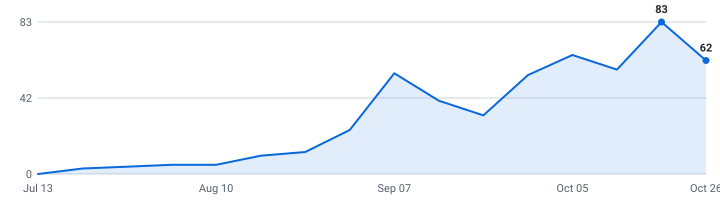

# 🎓 Summer 2027 and Fall 2026 Electrical Engineering Internships

**A self-updating engine that tracks Electrical Engineering internships so you don't have to.**

&nbsp;&nbsp;&nbsp;

### 406 open roles (292 listed below) · 69 new this week

4,811 employers tracked · data as of Oct 30, 2026 at 20:42 UTC

_245 have a cycle the employer stated · 161 are recent postings whose cycle isn't stated (listed separately, never mixed in)._

**[🖥️ Live dashboard](https://austinwright-eng.github.io/Automated-List-of-Electrical-Engineering-Internships/)** · **[📡 RSS](https://austinwright-eng.github.io/Automated-List-of-Electrical-Engineering-Internships/feed.xml)** · **[⚙️ JSON API](https://austinwright-eng.github.io/Automated-List-of-Electrical-Engineering-Internships/api/jobs.json)**

> [!TIP]
> **⭐ Star this repo** to save it and get updates when new roles are added.

Instead of refreshing a dozen career pages by hand, it reads company hiring feeds directly and keeps one live list — newest roles on top, refreshed automatically throughout the day.

**🔔 Follow new roles:** [RSS feed](https://austinwright-eng.github.io/Automated-List-of-Electrical-Engineering-Internships/feed.xml).

---

## What this is

This is an engine, not a hand-kept list. It polls company career feeds every 30 minutes, finds the internships, removes duplicates, and rebuilds this page on its own.

Every link comes straight from the source — so it's real and current, not a stale list someone forgot to update. Speed matters.

## What makes this different

| | |
|---|---|
| ⚡ **EE scope** | Electrical and related internships, with separate categories for circuits, digital, RF, power, embedded, and controls. Generic software and ambiguous systems/test titles are excluded. |
| 🛂 **Visa intel, computed** | 🇺🇸 / 🛂 flags detected automatically from every job description, plus ✓ for employers with a real H-1B track record (USCIS data, FY2022-23 — a history, not a promise). The big lists crowdsource this by hand; here it's code. Most postings say nothing either way, and those show as unknown rather than guessed. |
| 📆 **A real date on nearly every role** | Taken from the job portal itself wherever the portal states one, so newest-first actually means newest. The exact coverage figure is printed at the bottom of this page every run. |
| 🧰 **Skill tags + pay, extracted** | Every posting's text is scanned for the stack it wants (Python, C++, PyTorch, …) and the pay it states — searchable on the [dashboard](https://austinwright-eng.github.io/Automated-List-of-Electrical-Engineering-Internships/), and included in the CSV and API. |
| 🔔 **Alerts your way** | [RSS](https://austinwright-eng.github.io/Automated-List-of-Electrical-Engineering-Internships/feed.xml) — point any reader, or a Slack/Discord RSS integration, at it. Plus a [live dashboard](https://austinwright-eng.github.io/Automated-List-of-Electrical-Engineering-Internships/) with search, filters, and a saved-roles list that never leaves your browser. |
| ⚙️ **An engine, not a spreadsheet** | 5,101 job-board endpoints (4,811 distinct employers; some run more than one board) polled every 30 minutes across 12 ATS platforms. Full source and tests in this repo. |

## Scope

| | |
|---|---|
| **Roles** | Electrical/electronics, digital/semiconductors, RF, power, embedded/firmware, controls and instrumentation internships |
| **Region** | United States |
| **Cycles** | Summer 2027 and Fall 2026 |

## About

This EE fork builds on the upstream Internship Engine. See [EE development and upstream synchronization](EE_DEVELOPMENT.md).

Use it to spot roles early and apply before they fill up. Being first genuinely helps.

## Where this is going

I'm building this in the open and adding to it as it grows.

**Recently shipped:** email alerts · the Drop Radar · auto-detected sponsorship flags · the live dashboard

**Next up:** personalized alerts (pick your categories) · per-company hiring pages · a ghost-posting detector

If it helps you, a star means a lot and tells me to keep going.

## How to use

<b>Reading the table — flags, dates, and the cycle split</b> (click to expand)

- Roles are grouped by cycle below - **newest posting on top, oldest at the bottom.**
- A cycle section holds only roles whose **employer stated that cycle** - in the title, or in the posting's own text. Postings that name no cycle anywhere are in *Recently posted — cycle not stated* further down, with **no cycle guessed for them**. Same quality bar, different amount of evidence.
- **Apply** is the third column, right after the role, so the link is on screen even when the table is wider than your window.
- The **Posted** column is the date the company published the role.
- **_(3 openings)_ after a role title** = the employer has that many separate live requisitions for the same job, in the same place, for the same cycle. They're all real and each takes its own application, so they're linked individually (**Apply**, then **#2**, **#3**) instead of repeating the row. Counts still count requisitions, and the CSV export is never grouped.
- **🆁 after a company name** = **this role is remote** — the posting's own location or title says so. It marks the role on that row, not the whole company.
- **Flags after a role title:** 🇺🇸 = requires U.S. citizenship or a security clearance · 🛂 = the posting says it won't sponsor a work visa · 🆕 = spotted in the last 48 hours. Sponsorship flags are detected automatically from each job description - treat them as a strong hint and confirm on the posting.
- **✓ after a company name** = a real H-1B track record: USCIS approved 10+ petitions for that employer in FY2022–2023 (matched automatically against the official [H-1B Employer Data Hub](https://www.uscis.gov/tools/reports-and-studies/h-1b-employer-data-hub)). No ✓ doesn't mean they won't sponsor - it means we can't prove they have.
- Track your applications with [`data/internships.csv`](data/internships.csv) (opens in Excel / Google Sheets).
- Missing a company? Adding one takes a single line, see [CONTRIBUTING.md](CONTRIBUTING.md).

---

## Summer 2027  (164 employer-stated)

| Company | Role | Apply | Location | Skills | Posted |
|---|---|---|---|---|---|
| Global​Foundries | Device Engineering Intern, Silicon Photonics (Summer 2027) 🆕 | [Apply](https://globalfoundries.wd1.myworkdayjobs.com/External/job/USA---New-York---Malta/Device-Engineering-Intern--Silicon-Photonics--Summer-2027-_JR-2604263) | USA - New York - Malta | Python | Oct 30, 2026 |
| Stratolaunch | Manufactur​ing (Electrical) Engineering Intern Summer 2027 🇺🇸 🆕 | [Apply](https://job-boards.greenhouse.io/stratolaunch/jobs/5467832008) | Mojave, California, United States | No skills listed | Oct 30, 2026 |
| WSP | Electrical Engineering Intern (Substation) - Summer 2027 🆕 | [Apply](https://emit.fa.ca3.oraclecloud.com/hcmUI/CandidateExperience/en/sites/CX_2001/job/98467) | Burnsville +5 more | No skills listed | Oct 29, 2026 |
| RTX | Manufactur​ing Electrical Engineering Co-Op (Spring/Summer 2027) 🇺🇸 🆕 | [Apply](https://globalhr.wd5.myworkdayjobs.com/rec_rtx_ext_gateway/job/US-IA-CEDAR-RAPIDS-108--400-Collins-Rd-NE--BLDG-108/Manufacturing-Electrical-Engineering-Co-Op--Spring-Summer-2027-_01870653) | US-IA-CEDAR RAPIDS-108 ~ 400 Collins Rd… | No skills listed | Oct 29, 2026 |
| Johnson & Johnson | Electrical Engineering Intern - Robotics R&D 🛂 🆕 | [Apply](https://jj.wd5.myworkdayjobs.com/JJ/job/Santa-Clara-California-United-States-of-America/Electrical-Engineering-Intern---Robotics-R-D_R-099626-1) | Santa Clara +2 more | Python, MATLAB | Oct 29, 2026 |
| The Aerospace Corporation | 2027 Power Systems Engineering Graduate Intern 🇺🇸 🆕 | [Apply](https://aero.wd5.myworkdayjobs.com/external/job/El-Segundo-CA/XMLNAME-2027-Power-Systems-Engineering-Graduate-Intern_R016527) | El Segundo, CA | No skills listed | Oct 28, 2026 |
| The Aerospace Corporation | 2027 Power Systems Engineering Undergradu​ate Intern 🇺🇸 🆕 | [Apply](https://aero.wd5.myworkdayjobs.com/external/job/El-Segundo-CA/XMLNAME-2027-Power-Systems-Engineering-Undergraduate-Intern_R016530) | El Segundo, CA | No skills listed | Oct 28, 2026 |
| The Aerospace Corporation | 2027 Radio Frequency (RF) Spectrum Engineering Undergrad Intern 🇺🇸 🆕 | [Apply](https://aero.wd5.myworkdayjobs.com/external/job/El-Segundo-CA/XMLNAME-2027-Radio-Frequency--RF--Spectrum-Engineering-Undergrad-Intern_R017050) | El Segundo, CA | Python, C++, MATLAB | Oct 28, 2026 |
| Centene 🆁 | Digital Design Operations Intern (Master's - Summer 2027) | [Apply](https://centene.wd5.myworkdayjobs.com/Centene_External/job/Remote-MO/Digital-Design-Operations-Intern--Master-s---Summer-2027-_1667736) | Remote-MO | No skills listed | Oct 28, 2026 |
| Northrop Grumman | 2027 Electrical Engineer Intern- Gilbert AZ 🇺🇸 | [Apply](https://ngc.wd1.myworkdayjobs.com/Northrop_Grumman_External_Site/job/United-States-Arizona-Gilbert/XMLNAME-2027-Electrical-Engineer-Intern--Gilbert-AZ_R10258107) | United States-Arizona-Gilbert | No skills listed | Oct 28, 2026 |
| WSP | Electrical Engineering (Substation) Intern - Summer 2027 | [Apply](https://emit.fa.ca3.oraclecloud.com/hcmUI/CandidateExperience/en/sites/CX_2001/job/98455) | Richmond, VA, United States | No skills listed | Oct 28, 2026 |
| Draper | Analog ASIC Design Intern (Summer 2027) 🇺🇸 | [Apply](https://draper.wd5.myworkdayjobs.com/Draper_Careers/job/Cambridge-MA/Analog-ASIC-Design-Intern--Summer-2027-_JR003085) | Cambridge, MA | Python, MATLAB, Verilog | Oct 28, 2026 |
| Emerson Electric | Electrical Engineering Co-op (Summer 2027) | [Apply](https://hdjq.fa.us2.oraclecloud.com/hcmUI/CandidateExperience/en/sites/CX_1/job/26011003) | Elyria +5 more | Python, C++ | Oct 28, 2026 |
| WSP | Electrical Engineering Intern - Summer 2027 | [Apply](https://emit.fa.ca3.oraclecloud.com/hcmUI/CandidateExperience/en/sites/CX_2001/job/98370) | Tempe, AZ, United States | No skills listed | Oct 27, 2026 |
| Global Infrastruc​ture | Intern, Electrical Engineering Designer | [Apply](https://gi.wd1.myworkdayjobs.com/Global_Infrastructure/job/US--KS--Overland-Park---10561-Barkley-Street/Electrical-Engineering-Intern-Co-Op_6631) | US / KS / Overland Park - 10561 Barkley… | No skills listed | Oct 27, 2026 |
| Global​Foundries | Silicon Photonics Process Integration Intern (Summer 2027) | [Apply](https://globalfoundries.wd1.myworkdayjobs.com/External/job/USA---New-York---Malta/Silicon-Photonics-Process-Integration-Intern--Summer-2027-_JR-2604265) | USA - New York - Malta | Python, MATLAB | Oct 27, 2026 |
| Global Infrastruc​ture | Electrical Engineering Intern/Co-Op | [Apply](https://gi.wd1.myworkdayjobs.com/Global_Infrastructure/job/US--MO--Kansas-City---1600-Genessee-Street/Electrical-Engineering-Intern-Co-Op_6631) | US / MO / Kansas City - 1600 Genessee S… | No skills listed | Oct 27, 2026 |
| Global Infrastruc​ture | Intern, Electrical Engineering Designer | [Apply](https://gi.wd1.myworkdayjobs.com/Global_Infrastructure/job/US--MO--St-Louis---6-South-Old-Orchard/Intern--Electrical-Designer_6622) | US / MO / St. Louis - 6 South Old Orcha… | No skills listed | Oct 27, 2026 |
| Commonwealth Fusion Systems | Intern - Microwave Engineer - Summer 2027 | [Apply](https://jobs.lever.co/cfsenergy/79cd53ba-b864-4bcb-8421-60cf58f7df54) | Devens, MA | MATLAB | Oct 26, 2026 |
| Applied Materials ✓ | 2027 Summer Electrical Engineering Intern - BS or MS (Gloucester, MA) | [Apply](https://amat.wd1.myworkdayjobs.com/External/job/GloucesterMA/XMLNAME-2027-Summer-Electrical-Engineering-Intern---BS-or-MS--Gloucester--MA-_R2630812) | Gloucester​,MA | No skills listed | Oct 26, 2026 |
| HP IQ | Engineering Intern, Wireless Automation and Test (Summer 2027) | [Apply](https://job-boards.greenhouse.io/hpiq/jobs/6114741004) | San Francisco, CA | Python, Bash | Oct 26, 2026 |
| HP IQ | Electrical Engineering Intern, Hardware (Summer 2027) | [Apply](https://job-boards.greenhouse.io/hpiq/jobs/6116396004) | San Francisco, CA | Python | Oct 26, 2026 |
| Parallel Systems | Hardware Engineering Intern (Mechanical & Electrical) | [Apply](https://boards.greenhouse.io/parallel/jobs/5275660007?gh_jid=5275660007) | Los Angeles, CA | No skills listed | Oct 26, 2026 |
| IMEG ✓ | Electrical Engineering Intern / Rogers, AR 🛂 | [Apply](https://wd1.myworkdaysite.com/recruiting/imeg/Imeg_Careers/job/Rogers-AR/Electrical-Engineering-Intern---Rogers--AR_R-16496) | Rogers, AR | No skills listed | Oct 26, 2026 |
| General Dynamics Mission Systems | Electrical Engineer Co-Op (August - December 2027) 🇺🇸 | [Apply](https://careers-gdms.icims.com/jobs/74599/electrical-engineer-co-op-%28august---december-2027%29/job?in_iframe=1) | Mc​Leansville, NC, US | No skills listed | Oct 26, 2026 |
| Upscale AI | Advanced SerDes & Analog/Mixed-Signal IC Design Intern – Summer 2027 | [Apply](https://jobs.lever.co/upscale-ai/2bad3e47-6c00-4ec2-94b5-feb4009619c9) | US - Santa Clara, CA | Python, MATLAB | Oct 23, 2026 |
| Clean Harbors | Electrical Engineer Intern - Summer 2027 | [Apply](https://epyc.fa.us2.oraclecloud.com/hcmUI/CandidateExperience/en/sites/CX_1001/job/167556) | El Dorado, AR, United States | No skills listed | Oct 22, 2026 |
| American Electric Power ✓ | Electrical Engineering Intern- Summer 2027 🛂 | [Apply](https://aep.wd1.myworkdayjobs.com/AEPCareerSite/job/Columbus-OH/Electrical-Engineering-Intern--Summer-2027_R20503) | Columbus, OH | No skills listed | Oct 22, 2026 |
| IMEG ✓ | Electrical Engineering Intern / Madison, WI 🛂 | [Apply](https://wd1.myworkdaysite.com/recruiting/imeg/Imeg_Careers/job/Madison-WI/Electrical-Engineering-Intern---Madison--WI_R-16460) | Madison, WI | No skills listed | Oct 21, 2026 |
| Marvell | Silicon Validation Intern, BS - Summer 2027 | [Apply](https://marvell.wd1.myworkdayjobs.com/MarvellCareers/job/Santa-Clara-CA/Silicon-Validation-Intern--BS---Summer-2027_2603850-1) | Santa Clara, CA | Python | Oct 21, 2026 |
| Northrop Grumman | 2027 Electrical Engineer Intern - Redondo Beach CA 🇺🇸 _(4 openings)_ | [Apply](https://ngc.wd1.myworkdayjobs.com/Northrop_Grumman_External_Site/job/United-States-California-Redondo-Beach/XMLNAME-2027-Electrical-Engineer-Intern---Redondo-Beach-CA_R10257204) [#2](https://ngc.wd1.myworkdayjobs.com/Northrop_Grumman_External_Site/job/United-States-California-Redondo-Beach/XMLNAME-2027-Electrical-Engineer-Intern--Redondo-Beach-CA_R10258121) [#3](https://ngc.wd1.myworkdayjobs.com/Northrop_Grumman_External_Site/job/United-States-California-Redondo-Beach/XMLNAME-2027-Electrical-Engineer-Intern--Redondo-Beach-CA_R10258125) [#4](https://ngc.wd1.myworkdayjobs.com/Northrop_Grumman_External_Site/job/United-States-California-Redondo-Beach/XMLNAME-2027-Electrical-Engineer-Intern--Redondo-Beach-CA_R10258128) | United States-California-Redondo Beach | No skills listed | Oct 21, 2026 |
| Smith+Nephew ✓ | Intern Electrical Engineering | [Apply](https://smithnephew.wd5.myworkdayjobs.com/External/job/Andover-MA/Intern-Electrical-Engineering_R92957) | Andover, MA | No skills listed | Oct 21, 2026 |
| Smith+Nephew ✓ | Co-Op Embedded Software Engineering | [Apply](https://smithnephew.wd5.myworkdayjobs.com/External/job/Andover-MA/Intern-Embedded-Software-Engineering_R92952) | Andover, MA | C++, Computer Vision | Oct 21, 2026 |
| Skydio ✓ | Wireless Hardware Engineer Intern - Summer 2027 | [Apply](https://jobs.ashbyhq.com/skydio/1ac972b1-8094-4765-8869-63e1c4d50dea) | San Mateo, California, United States | Python | Oct 20, 2026 |
| Skydio ✓ | Hardware Test and Reliability Intern - Summer 2027 | [Apply](https://jobs.ashbyhq.com/skydio/36d75e36-eeb2-4399-8887-37c4a5ff5800) | San Mateo, California, United States | Python | Oct 20, 2026 |
| Stantec | Electrical Engineering Intern - Buildings (Summer 2027) | [Apply](https://hdhl.fa.us6.oraclecloud.com/hcmUI/CandidateExperience/en/sites/CX_1/job/1008372) | Austin, TX, United States | No skills listed | Oct 20, 2026 |
| Stantec | Electrical Engineering Intern - Buildings (Summer 2027) | [Apply](https://hdhl.fa.us6.oraclecloud.com/hcmUI/CandidateExperience/en/sites/CX_1/job/1008416) | Plano, TX, United States | No skills listed | Oct 20, 2026 |
| Stantec | Electrical Engineering Intern - Buildings (Summer 2027) | [Apply](https://hdhl.fa.us6.oraclecloud.com/hcmUI/CandidateExperience/en/sites/CX_1/job/1008417) | Dallas, TX, United States | No skills listed | Oct 20, 2026 |
| CACI | Electrical Test Engineering Intern - Summer 2027 | [Apply](https://caci.wd1.myworkdayjobs.com/external/job/Danbury-CT-US/Electrical-Test-Engineering-Intern---Summer-2027_333809) | Danbury, CT, US | Python | Oct 20, 2026 |
| Hitachi Energy | Controls Engineering Internship | [Apply](https://hitachi.wd1.myworkdayjobs.com/hitachi/job/Ogden-Utah-United-States/Controls-Engineering-Internship_R0148732) | Ogden, Utah, United States | No skills listed | Oct 20, 2026 |
| IMEG ✓ | Electrical Engineering Co-op / Philadelph​ia, PA 🛂 | [Apply](https://wd1.myworkdaysite.com/recruiting/imeg/Imeg_Careers/job/Philadelphia-PA/Electrical-Engineering-Co-op---Philadelphia--PA_R-16907) | Philadelph​ia, PA | No skills listed | Oct 20, 2026 |
| Moog | Intern, Electrical Engineering | [Apply](https://moog.wd5.myworkdayjobs.com/moog_external_career_site/job/Torrance-CA/Intern--Electrical-Engineering_R-26-19827) | Torrance, CA | C++, MATLAB, Verilog | Oct 20, 2026 |
| Rockwell Automation ✓ | Intern, Hardware Development Engineer (May - Aug 2027) 🛂 | [Apply](https://rockwellautomation.wd1.myworkdayjobs.com/External-Rockwell-Automation-Early-Careers/job/Mayfield-Heights-Ohio-United-States/Intern--Hardware-Development-Engineer--May---Aug-2027-_R26-6892-2) | Mayfield Heights, Ohio, United States | Python, C++ | Oct 20, 2026 |
| Anduril | 2027 Guidance, Navigation, & Control Engineer Intern | [Apply](https://boards.greenhouse.io/andurilindustries/jobs/5268736007?gh_jid=5268736007) | Costa Mesa, California, United States | MATLAB, Computer Vision | Oct 19, 2026 |
| Nissan | Mechanical & Electrical Engineer Intern - Summer 2027 - Canton, MS 🛂 | [Apply](https://alliance.wd3.myworkdayjobs.com/nissanjobs/job/Canton-Mississippi---United-States-of-America/Mechanical---Electrical-Engineer-Intern---Summer-2027---Canton--MS_R00214259) | Canton +1 more | No skills listed | Oct 19, 2026 |
| Charter Manufactur​ing | Controls Engineer Intern (Summer 2027) | [Apply](https://chartermfg.wd5.myworkdayjobs.com/Charter_Careers/job/Charter-Aarrowcast---Shawano-WI/Controls-Engineer-Intern--Summer-2027-_R08167) | Charter Aarrowcast - Shawano, WI | SQL | Oct 19, 2026 |
| Charter Manufactur​ing | Electrical Maintenance Engineer Intern (Summer 2027) | [Apply](https://chartermfg.wd5.myworkdayjobs.com/Charter_Careers/job/Charter-Aarrowcast---Shawano-WI/Electrical-Maintenance-Engineer-Intern--Summer-2027-_R08189) | Charter Aarrowcast - Shawano, WI | No skills listed | Oct 19, 2026 |
| Global​Foundries | Foundation IP Design Verification Intern (Summer 2027) | [Apply](https://globalfoundries.wd1.myworkdayjobs.com/External/job/USA---California---Santa-Clara/Foundation-IP-Design-Verification-Intern--Summer-2027-_JR-2604356) | USA - California - Santa Clara | Python, Verilog | Oct 16, 2026 |
| ADT ✓ | Hardware Engineering & Connected Devices Internship 🛂 | [Apply](https://fa-erqb-saasfaprod1.fa.ocs.oraclecloud.com/hcmUI/CandidateExperience/en/sites/CX_1/job/3022475) | Boca Raton, FL, United States | No skills listed | Oct 16, 2026 |
| Sierra Nevada Corporation | Electrical Engineering Intern - Summer 2027 (For SNC Summer 2026 Interns Only) | [Apply](https://snc.wd1.myworkdayjobs.com/snc_external_career_site/job/Lone-Tree-CO/Electrical-Engineering-Intern---Summer-2027--For-SNC-Summer-2026-Interns-Only-_R0031088) | Lone Tree, CO | MATLAB | Oct 16, 2026 |
| Inversion Space | Avionics Mechanical Engineer - Summer Internship 2027 🇺🇸 | [Apply](https://job-boards.greenhouse.io/inversionspace/jobs/4744390005) | Playa Vista, California, United States | No skills listed | Oct 15, 2026 |
| Commonwealth Fusion Systems | Intern - Controls Engineer - Summer 2027 | [Apply](https://jobs.lever.co/cfsenergy/e3408817-347e-45bc-8627-305b75b6b978) | Milpitas, CA | No skills listed | Oct 15, 2026 |
| Inversion Space | Avionics Embedded Software Engineer - Summer Internship 2027 🇺🇸 | [Apply](https://job-boards.greenhouse.io/inversionspace/jobs/4744391005) | Playa Vista, California, United States | Python, C++, Linux, Git | Oct 15, 2026 |
| Lawrence Livermore National Laboratory (LLNL) | Power Systems Graduate Intern - Cyber and Critical Infrastruc​ture Summer Institute - Summer 2027 🇺🇸 | [Apply](https://jobs.smartrecruiters.com/LLNL/3743990016165506) | Livermore, CA, United States | Python, C++, MATLAB | Oct 15, 2026 |
| Lawrence Livermore National Laboratory (LLNL) | Power Systems Undergradu​ate Intern - Cyber and Critical Infrastruc​ture Summer Institute - Summer 2027 🇺🇸 | [Apply](https://jobs.smartrecruiters.com/LLNL/3743990016164416) | Livermore, CA, United States | Python, C++, MATLAB | Oct 15, 2026 |
| Charter Manufactur​ing | Electrical Controls Engineer Intern (Summer 2027) | [Apply](https://chartermfg.wd5.myworkdayjobs.com/Charter_Careers/job/Charter-Wire---81st-Street---Milwaukee-WI/Electrical-Controls-Engineer-Intern_R08114) | Charter Wire - 81st Street - Milwaukee +1 more | Python, Java, SQL | Oct 14, 2026 |
| Motorola | Electrical Engineer / PCB Designer Intern - Summer 2027 🇺🇸 | [Apply](https://motorolasolutions.wd5.myworkdayjobs.com/Careers/job/Plantation-FL/Electrical-Engineer---PCB-Designer-Intern---Summer-2027_R69679) | Plantation, FL | No skills listed | Oct 14, 2026 |
| Rockwell Automation ✓ | Co-op, Electrical Engineer (June - Dec 2027) 🛂 | [Apply](https://rockwellautomation.wd1.myworkdayjobs.com/External-Rockwell-Automation-Early-Careers/job/Chelmsford-Massachusetts-United-States/Co-op--Electrical-Engineer--June---Dec-2027-_R26-7706) | Chelmsford, Massachuse​tts, United States | Python, MATLAB | Oct 14, 2026 |
| Rockwell Automation ✓ | Co-op, Hardware Development Engineer (June - Dec 2027) 🛂 | [Apply](https://rockwellautomation.wd1.myworkdayjobs.com/External-Rockwell-Automation-Early-Careers/job/Mayfield-Heights-Ohio-United-States/Co-op--Hardware-Development-Engineer--June---Dec-2027-_R26-6891) | Mayfield Heights, Ohio, United States | Python, C++ | Oct 14, 2026 |
| Amazon ✓ | ASIC Engineer Intern, Summer 2027 | [Apply](https://www.amazon.jobs/en/jobs/10576619/asic-engineer-intern-summer-2027) | Sunnyvale, California, USA | C++, Verilog | Oct 13, 2026 |
| Amazon ✓ | Hardware Development Engineer Intern,  Summer 2027 | [Apply](https://www.amazon.jobs/en/jobs/10578090/hardware-development-engineer-intern-summer-2027) | Sunnyvale, California, USA | No skills listed | Oct 13, 2026 |
| Inversion Space | RF Engineer - Summer Internship 2027 🇺🇸 | [Apply](https://job-boards.greenhouse.io/inversionspace/jobs/4743497005) | Playa Vista, California, United States | Python, MATLAB | Oct 13, 2026 |
| Howmet Aerospace | Intern & Co-op – Electrical/Controls Engineer - Whitehall, MI (2027) 🛂 | [Apply](https://fa-exty-saasfaprod1.fa.ocs.oraclecloud.com/hcmUI/CandidateExperience/en/sites/CX_1/job/119924) | Whitehall, MI, United States | No skills listed | Oct 13, 2026 |
| STV ✓ | Electrical Engineering Intern - Summer 2027 🛂 | [Apply](https://stvinc.wd5.myworkdayjobs.com/stv/job/Oklahoma-City-Oklahoma/Electrical-Engineering-Intern---Summer-2027_JR6227) | Oklahoma City, Oklahoma | No skills listed | Oct 13, 2026 |
| Anduril | 2027 Firmware Engineer Intern | [Apply](https://boards.greenhouse.io/andurilindustries/jobs/5265158007?gh_jid=5265158007) | Costa Mesa, California, United States | Computer Vision | Oct 13, 2026 |
| DoorDash ✓ | Electrical Engineer, Intern - Labs (Summer 2027) | [Apply](https://job-boards.greenhouse.io/doordashusa/jobs/8274095) | Oakland, CA | Python, C++ | Oct 12, 2026 |
| NVIDIA ✓ | PCIe Design Verification Intern - Summer 2027 | [Apply](https://nvidia.wd5.myworkdayjobs.com/NVIDIAExternalCareerSite/job/US-TX-Austin/PCIe-Design-Verification-Intern---Summer-2027_JR2026708) | US, TX, Austin | Python, Verilog | Oct 12, 2026 |
| Applied Materials ✓ | 2027 Summer Electrical Engineer  Intern (Controls/PCB) - BS or MS (Gloucester, MA) | [Apply](https://amat.wd1.myworkdayjobs.com/External/job/GloucesterMA/XMLNAME-2027-Summer-Electrical-Engineer--Intern--Controls-PCB----BS-or-MS--Gloucester--MA-_R2630658) | Gloucester​,MA | No skills listed | Oct 09, 2026 |
| Applied Materials ✓ | 2027 Summer Intern - Electrical Engineer - BS/MS Degree, (Santa Clara) | [Apply](https://amat.wd1.myworkdayjobs.com/External/job/Santa-ClaraCA/XMLNAME-2027-Summer-Intern---Electrical-Engineer---BS-MS-Degree---Santa-Clara-_R2629428) | Santa Clara,CA | No skills listed | Oct 09, 2026 |
| Draper | Integrated Circuits Intern (Summer 2027) 🇺🇸 | [Apply](https://draper.wd5.myworkdayjobs.com/Draper_Careers/job/Cambridge-MA/Integrated-Circuits-Intern_JR002973) | Cambridge, MA | Python, MATLAB, Verilog | Oct 09, 2026 |
| RTX | Power Electronics Intern (Summer 2027) 🇺🇸 | [Apply](https://globalhr.wd5.myworkdayjobs.com/Private_Posting_No_TMP/job/US-IA-CEDAR-RAPIDS-106--400-Collins-Rd-NE--BLDG-106/Power-Electronics-Intern--Summer-2027-_01869165) | US-IA-CEDAR RAPIDS-106 ~ 400 Collins Rd… | No skills listed | Oct 09, 2026 |
| STV ✓ | Electrical Engineering Intern - Summer 2027 🛂 | [Apply](https://stvinc.wd5.myworkdayjobs.com/stv/job/Boston-Massachusetts/Electrical-Engineering-Intern---Summer-2027_JR6127) | Boston, Massachuse​tts | No skills listed | Oct 09, 2026 |
| Rugged Robotics | Electrical Engineering Intern/Co-op (Spring or Summer '27) | [Apply](https://job-boards.greenhouse.io/ruggedrobotics/jobs/4724214005) | Houston, TX | No skills listed | Oct 08, 2026 |
| Amazon ✓ | Software Development Engineer (Embedded Systems) Intern, Amazon Leo - Summer 2027 (USA) 🇺🇸 | [Apply](https://www.amazon.jobs/en/jobs/10571374/software-development-engineer-embedded-systems-intern-amazon-leo-summer-2027-usa) | Redmond, Washington, USA | Python, Java, C++, C# | Oct 07, 2026 |
| Carpenter Technology | Maintenance Intern - Electrical | [Apply](https://cartech.wd5.myworkdayjobs.com/CTCExternal/job/Reading-PA/Maintenance-Intern---Electrical_26884) | Reading, PA | No skills listed | Oct 06, 2026 |
| The Toro Company | Electronics Technician Intern - The Toro Company 🛂 | [Apply](https://ttc.wd1.myworkdayjobs.com/Toro_External_Careers/job/Bloomington-MN/Electronics-Technician-Intern---The-Toro-Company_JR17552) | Bloomington, MN | No skills listed | Oct 06, 2026 |
| Arc | Electrical Integration Engineering Intern | [Apply](https://job-boards.greenhouse.io/arcboatcompany/jobs/5442838008) | Torrance, CA | MATLAB | Oct 05, 2026 |
| Arc | Vehicle Controls Engineering Intern | [Apply](https://job-boards.greenhouse.io/arcboatcompany/jobs/5442902008) | Torrance, CA | MATLAB | Oct 05, 2026 |
| Arc | Electrical Engineering Intern - Powertrain | [Apply](https://job-boards.greenhouse.io/arcboatcompany/jobs/5443971008) | Torrance, CA | Python | Oct 05, 2026 |
| Hitachi Energy | Controls Engineering Internship/Co-op | [Apply](https://hitachi.wd1.myworkdayjobs.com/hitachi/job/Auburn-Hills-Michigan-United-States/Controls-Engineering-Internship-Co-op_R0143858) | Auburn Hills, Michigan, United States | No skills listed | Oct 05, 2026 |
| Hitachi Energy | Controls Engineering Internship/Co-op _(2 openings)_ | [Apply](https://hitachi.wd1.myworkdayjobs.com/hitachi/job/Holland-Michigan-United-States/Controls-Engineering-Internship-Co-op_R0144971) [#2](https://hitachi.wd1.myworkdayjobs.com/hitachi/job/Holland-Michigan-United-States/Controls-Engineering-Internship-Co-op_R0144972) | Holland, Michigan, United States | No skills listed | Oct 05, 2026 |
| Marvell | Hardware Engineer Intern, BS - Summer 2027 | [Apply](https://marvell.wd1.myworkdayjobs.com/marvellcareers2/job/Santa-Clara-CA/Hardware-Engineer-Intern--BS---Summer-2027_2604975) | Santa Clara, CA | Linux | Oct 05, 2026 |
| Muon Space | Electrical Engineering Intern (Summer 2027) | [Apply](https://job-boards.greenhouse.io/muonspace/jobs/5255112007) | San Jose, CA | Python, C++ | Oct 01, 2026 |
| Varda Space | Avionics Engineering Internship - Summer 2027 🇺🇸 | [Apply](https://job-boards.greenhouse.io/vardaspace/jobs/8010158003) | El Segundo, California, United States | Python | Oct 01, 2026 |
| CoStar Group | Embedded Software Engineering Intern 🛂 | [Apply](https://costar.wd1.myworkdayjobs.com/Costar_Campus/job/Sunnyvale-US/Embedded-Software-Engineering-Intern_R39950) | Sunnyvale (US) | Python, C++, MATLAB, PyTorch | Oct 01, 2026 |
| Xcimer Energy | Summer 2027 Internship - Electrical Engineering 🇺🇸 | [Apply](https://jobs.lever.co/xcimer/87bceb04-faeb-4365-9fed-d8f5cd3fb8ac) | Denver, CO | No skills listed | Sep 30, 2026 |
| ABB ✓ | Electrical Design Engineer Intern- Summer 2027 🛂 | [Apply](https://abb.wd3.myworkdayjobs.com/external_career_page/job/Fort-Smith-Arkansas-United-States-of-America/Electrical-Design-Engineer-Intern--Summer-2027_JR00045726) | Fort Smith +2 more | No skills listed | Sep 30, 2026 |
| Muon Space | GNC Hardware Engineering Intern (Summer 2027) | [Apply](https://job-boards.greenhouse.io/muonspace/jobs/5252677007) | Mountain View, CA | No skills listed | Sep 29, 2026 |
| nVent | Electrical/Controls Engineering Co-Op (June - December 2027) | [Apply](https://nvent.wd5.myworkdayjobs.com/nVent/job/Anoka-MN-US/Electrical-Controls-Engineering-Co-Op_R23626) | Anoka, MN, US | No skills listed | Sep 29, 2026 |
| Hermeus | Flight Software Engineering Intern (Simulation/Hardware-In-The-Loop) - Spring & Summer 2027 🇺🇸 | [Apply](https://jobs.lever.co/hermeus/78008094-ca81-4a0c-9a18-93b30f932acd) | Los Angeles, CA | Python, C++, MATLAB, Linux | Sep 29, 2026 |
| General Dynamics Mission Systems | Electrical Engineering Intern (Summer 2027) 🇺🇸 | [Apply](https://careers-gdms.icims.com/jobs/75138/electrical-engineering-intern-%28summer-2027%29/job?in_iframe=1) | West Valley City, UT, US | No skills listed | Sep 28, 2026 |
| General Dynamics Mission Systems | Electrical Engineering Intern (Summer 2027) 🇺🇸 | [Apply](https://careers-gdms.icims.com/jobs/75140/electrical-engineering-intern-%28summer-2027%29/job?in_iframe=1) | Manassas, VA, US | No skills listed | Sep 28, 2026 |
| HNTB ✓ | WED - Intern Electrical Power System (Summer 2027) (For Current & Recent HNTB Interns Only) 🛂 | [Apply](https://hntb.wd5.myworkdayjobs.com/hntb_careers/job/Los-Angeles-CA-Figueroa-Street/WED---Intern-Electrical-Power-System--Summer-2027---For-Current---Recent-HNTB-Interns-Only-_R-31767-1) | Los Angeles, CA (Figueroa Street) | No skills listed | Sep 28, 2026 |
| AtkinsRéalis | Instrument​ation & Controls Engineering Intern - Summer 2027 | [Apply](https://slihrms.wd3.myworkdayjobs.com/careers/job/USWABothell/Instrumentation---Controls-Engineering-Intern---Summer-2027_R-162442-1) | US.WA.Both​ell | No skills listed | Sep 28, 2026 |
| Philips | Intern – Embedded Systems Test Automation Engineer – Bothell, WA – Summer 2027 | [Apply](https://philips.wd3.myworkdayjobs.com/jobs-and-careers/job/Bothell-Washington-United-States/Intern---Embedded-Systems-Test-Automation-Engineer---Bothell--WA---Summer-2027_592074) | Bothell, Washington, United States | Python, C++ | Sep 28, 2026 |
| Helion Energy | Electrical Engineering Summer 2027 Intern | [Apply](https://jobs.ashbyhq.com/helion/045d97eb-5efd-4e35-90f5-65eebe3363f4) | Everett, WA | No skills listed | Sep 25, 2026 |
| Mach Industries | Summer 2027 Engineering Internship, Electrical 🛂 | [Apply](https://job-boards.greenhouse.io/machindustries/jobs/4420623009) | Huntington Beach +5 more | No skills listed | Sep 25, 2026 |
| The Toro Company | Electrical Engineering Intern - The Toro Company 🛂 | [Apply](https://ttc.wd1.myworkdayjobs.com/Toro_External_Careers/job/Bloomington-MN/Electrical-Engineering-Intern---The-Toro-Company_JR17124) | Bloomington, MN | Python | Sep 25, 2026 |
| Zurn Elkay Water Solutions | Embedded Firmware Intern (Summer 2027) | [Apply](https://elkay.wd1.myworkdayjobs.com/Elkay_External/job/Milwaukee-WI/Embedded-Firmware-Intern--Summer-2027-_REQ-020150-1) | Milwaukee, WI | C++ | Sep 25, 2026 |
| Zurn Elkay Water Solutions | Embedded Hardware Intern (Summer 2027) | [Apply](https://elkay.wd1.myworkdayjobs.com/Elkay_External/job/Milwaukee-WI/Embedded-Hardware-Intern--Summer-2027-_REQ-020151) | Milwaukee, WI | No skills listed | Sep 25, 2026 |
| Stanley Black & Decker ✓ | Electrical Engineering Intern Summer 2027 🛂 | [Apply](https://sbdinc.wd1.myworkdayjobs.com/Stanley_Black_Decker_Career_Site/job/Towson-MD-United-States/Electrical-Engineering-Intern-Summer-2027_REQ-1000052018) | Towson, MD, United States | No skills listed | Sep 24, 2026 |
| Xcimer Energy | Summer 2027 Internship - Controls Systems Engineering 🇺🇸 | [Apply](https://jobs.lever.co/xcimer/4b031cd4-5f45-4d53-9332-dd23bc349480) | Denver, CO | No skills listed | Sep 22, 2026 |
| Marvell | Electrical Validation Intern, BS - Summer 2027 | [Apply](https://marvell.wd1.myworkdayjobs.com/MarvellCareers/job/Santa-Clara-CA/Electrical-Validation-Intern--BS---Summer-2027_2603795-1) | Santa Clara, CA | Python | Sep 22, 2026 |
| Formlabsin​ternships | Embedded Software Intern (Summer 2027) | [Apply](https://job-boards.greenhouse.io/formlabsinternships/jobs/8222268) | Somerville, MA | Python, C++, Linux | Sep 21, 2026 |
| Rocket Lab | Electrical Engineering Intern Summer 2027 🇺🇸 | [Apply](https://job-boards.greenhouse.io/rocketlab/jobs/7998598003) | Pasadena, CA | No skills listed | Sep 17, 2026 |
| Rendezvous Robotics | Avionics Engineering Intern (Summer 2027) | [Apply](https://job-boards.greenhouse.io/rendezvousrobotics/jobs/4408578009) | Golden, CO | No skills listed | Sep 16, 2026 |
| Rehiko | Electrical Engineering Intern 2027 | [Apply](https://rehlko.wd12.myworkdayjobs.com/Reh/job/SheboyganWI/Electrical-Engineering-Intern-2027_R04824) | Sheboygan,WI | No skills listed | Sep 16, 2026 |
| AspenTech | Power System Engineering Intern - Digital Grid Management - Summer 2027 | [Apply](https://aspentech.wd5.myworkdayjobs.com/aspentech/job/Medina-Minnesota/Power-System-Engineering-Intern---Digital-Grid-Management---Summer-2027_R9458) | Medina, Minnesota | Python, Linux | Sep 15, 2026 |
| nVent | Electrical Engineering Co-Op (June - Dec 2027) | [Apply](https://nvent.wd5.myworkdayjobs.com/nVent/job/Solon-OH-US/Electrical-Engineering-Co-Op_R23593) | Solon, OH, US | MATLAB | Sep 15, 2026 |
| Bedrock Robotics | 2027 Internship Hardware Engineer, Machine Integration & Test | [Apply](https://jobs.ashbyhq.com/bedrock-robotics/c9c08251-6a42-4f9c-be4d-2621995cc8f9) | San Francisco, CA | No skills listed | Sep 14, 2026 |
| Michael Baker Internatio​nal ✓ | Electrical Engineering Intern, Summer 2027 | [Apply](https://ebxs.fa.us2.oraclecloud.com/hcmUI/CandidateExperience/en/sites/CX_2/job/309857) | San Diego, CA, United States | No skills listed | Sep 14, 2026 |
| Formlabsin​ternships | Electrical Engineering Intern (Summer 2027) | [Apply](https://job-boards.greenhouse.io/formlabsinternships/jobs/8148251) | Somerville, MA | Python | Sep 13, 2026 |
| Formlabsin​ternships | Hardware R&D Engineering Intern (Summer 2027) | [Apply](https://job-boards.greenhouse.io/formlabsinternships/jobs/8172394) | Somerville, MA | Python, MATLAB | Sep 13, 2026 |
| Xcimer Energy | Summer 2027 Internship - Pulsed Power Engineering 🇺🇸 | [Apply](https://jobs.lever.co/xcimer/39fd5473-58a8-446c-86fb-258c1dd0f67d) | Denver, CO | No skills listed | Sep 11, 2026 |
| Emerson Electric | Hardware Design Engineer Intern | [Apply](https://hdjq.fa.us2.oraclecloud.com/hcmUI/CandidateExperience/en/sites/CX_1/job/26010801) | Round Rock, TX, United States | Python, C++, MATLAB, Verilog | Sep 11, 2026 |
| Motorola | DSP (Digital Signal Processing) Software Engineering Intern - Summer 2027 | [Apply](https://motorolasolutions.wd5.myworkdayjobs.com/Careers/job/Plantation-FL/DSP--Digital-Signal-Processing--Software-Engineering-Intern---Summer-2027_R68734) | Plantation, FL | Python, C++, MATLAB, Linux | Sep 11, 2026 |
| The Toro Company | Embedded Software Engineering Intern - The Toro Company 🛂 _(2 openings)_ | [Apply](https://ttc.wd1.myworkdayjobs.com/Toro_External_Careers/job/Bloomington-MN/Embedded-Software-Engineering-Intern---The-Toro-Company_JR17114) [#2](https://ttc.wd1.myworkdayjobs.com/Toro_External_Careers/job/Bloomington-MN/Embedded-Software-Engineering-Intern---The-Toro-Company_JR17125) | Bloomington, MN | C++, C# | Sep 11, 2026 |
| Bedrock Robotics | 2027 Internship Sensor Hardware Test Engineer | [Apply](https://jobs.ashbyhq.com/bedrock-robotics/1f413f83-b897-4938-a19e-ab91bd326c51) | San Francisco, CA | Python, Git | Sep 10, 2026 |
| Bedrock Robotics | 2027 Internship Hardware Engineer | [Apply](https://jobs.ashbyhq.com/bedrock-robotics/949feb1b-c60f-43c5-94de-7dd9cd70ba4a) | San Francisco, CA | Python, C++, Rust, Git | Sep 10, 2026 |
| Rocket Lab | Test Engineering Intern - Avionics Summer 2027 🇺🇸 | [Apply](https://job-boards.greenhouse.io/rocketlab/jobs/7987159003) | Long Beach, CA | Python, JavaScript | Sep 10, 2026 |
| Rocket Lab | Electrical Engineering Intern Summer 2027 🇺🇸 | [Apply](https://job-boards.greenhouse.io/rocketlab/jobs/7990683003) | Long Beach, CA | Python, C++, Verilog | Sep 10, 2026 |
| Avav | Summer 2027 Embedded Software Engineering Intern | [Apply](https://avav.wd1.myworkdayjobs.com/avav/job/Simi-Valley-CA/Summer-2027-Embedded-Software-Engineering-Intern_8549) | Simi Valley, CA | Python, C++, Linux | Sep 10, 2026 |
| Saronic | Electrical Engineer Intern (Summer 2027) 🇺🇸 | [Apply](https://jobs.ashbyhq.com/saronic/c7779462-3c4c-44d9-8314-1be93a0e478a) | Austin, TX | Python, C++, Linux | Sep 09, 2026 |
| Pacific Fusion | Summer 2027 Internship - Electrical Engineering | [Apply](https://job-boards.greenhouse.io/pacificfusion/jobs/4398021009) | San Leandro +3 more | Python, MATLAB | Sep 09, 2026 |
| Hermeus | Avionics Electrical Engineering Intern - Spring/Summer 2027 🇺🇸 | [Apply](https://jobs.lever.co/hermeus/b7babdb5-64ee-49ad-a193-918d6a31c462) | Atlanta, GA | C++ | Sep 09, 2026 |
| RESPEC | Student Engineering Intern (Mechanical or Electrical) _(2 openings)_ | [Apply](https://jobs.smartrecruiters.com/RESPECInc/744000148594874) [#2](https://jobs.smartrecruiters.com/RESPECInc/744000157237049) | Anchorage, AK, United States | No skills listed | Sep 09, 2026 |
| Motorola | FPGA Design Engineering Intern - Summer 2027 🇺🇸 | [Apply](https://motorolasolutions.wd5.myworkdayjobs.com/Careers/job/Schaumburg-IL/FPGA-Design-Engineering-Intern---Summer-2027_R68401) | Schaumburg, IL | Python, Verilog | Sep 09, 2026 |
| Allen Control Systems | Electrical Engineering Intern, 2027 | [Apply](https://jobs.ashbyhq.com/allen-control-systems/cc1618f1-e4b8-4dcb-88fd-9771da972220) | Austin, TX | Computer Vision | Sep 08, 2026 |
| RF-SMART | Hardware Support Internship - Summer 2027 🛂 | [Apply](https://job-boards.greenhouse.io/rfsmart/jobs/5407220008) | Jacksonvil​le, Florida, United States | No skills listed | Sep 08, 2026 |
| Sensata | Electrical Engineer Intern (Dynapower) - Summer 2027 | [Apply](https://sensata.wd1.myworkdayjobs.com/Sensata-Careers/job/Dynapower-South-Burlington-VT/Electrical-Engineer-Intern--Dynapower----Summer-2027_IRC98423) | Dynapower South Burlington, VT | No skills listed | Sep 08, 2026 |
| Stryker ✓ | Summer 2027 Internship - Electrical Engineering - Florida | [Apply](https://stryker.wd1.myworkdayjobs.com/StrykerCareers/job/Weston-Florida/Electrical-Engineering-Intern---Weston--FL_R572740) | Weston, Florida | No skills listed | Sep 08, 2026 |
| Wavetronix | Electrical/Computer Engineering Internship Summer 2027 | [Apply](https://wavetronix.breezy.hr/p/0f4b5eea457a-electrical-computer-engineering-internship-summer-2027) | Springville, UT | No skills listed | Sep 04, 2026 |
| AMCA | Electrical Engineering Internship (Summer 2027) | [Apply](https://job-boards.greenhouse.io/amca/jobs/4396690009) | El Segundo, CA | No skills listed | Sep 04, 2026 |
| HNTB ✓ | Intern Electrical and Mechanical/Fire Protection Engineering (Summer 2027) 🛂 | [Apply](https://hntb.wd5.myworkdayjobs.com/hntb_careers/job/Bellevue-WA-Seattle/Intern-Electrical-and-Mechanical-Fire-Protection-Engineering--Summer-2027-_R-31482-1) | Bellevue, WA (Seattle) | No skills listed | Sep 04, 2026 |
| Vermeer | Electrical Engineer Internship Summer 2027 | [Apply](https://vermeer.wd5.myworkdayjobs.com/externalcareersite/job/Pella-Iowa-USA---Corporate-Office/Electrical-Engineer-Internship-Summer-2027_REQ-22166) | Pella, Iowa, USA - Corporate Office | MATLAB | Sep 04, 2026 |
| Sierra Nevada Corporation | Electrical Engineering Intern (Summer 2027) 🇺🇸 | [Apply](https://snc.wd1.myworkdayjobs.com/snc_external_career_site/job/Plano-TX/Electrical-Engineering-Intern--Summer-2027-_R0030740) | Plano, TX | MATLAB | Sep 03, 2026 |
| General Matter | Summer 2027 Internship - Embedded Software Engineering | [Apply](https://job-boards.greenhouse.io/generalmatter/jobs/5377131008) | Los Angeles, CA | Python, C++, Go, Rust | Sep 02, 2026 |
| K2 Space | Electrical Engineering Intern – Summer 2027 🇺🇸 | [Apply](https://job-boards.greenhouse.io/k2spacecorporation/jobs/5411918008) | Los Angeles, CA | Python, C++, MATLAB | Sep 01, 2026 |
| K2 Space | RF Engineering Intern – Summer 2027 🇺🇸 | [Apply](https://job-boards.greenhouse.io/k2spacecorporation/jobs/5411919008) | Los Angeles, CA | No skills listed | Sep 01, 2026 |
| K2 Space | Avionics Systems/Test Engineering Intern – Summer 2027 🇺🇸 | [Apply](https://job-boards.greenhouse.io/k2spacecorporation/jobs/5411921008) | Los Angeles, CA | Python, C++, Rust, Bash | Sep 01, 2026 |
| FOTH | Electrical Engineering Co-op (Summer/Fall 2027) | [Apply](https://jobs.lever.co/foth/e59ed4a4-4dd7-4cb2-91a3-c528e5752985) | Green Bay, Wisconsin | No skills listed | Sep 01, 2026 |
| Shield AI | Summer 2027 - Electrical Engineering Intern | [Apply](https://jobs.lever.co/shieldai/200a293f-71ce-4982-a100-ac4b500c4cf7) | Dallas, Texas | Python | Sep 01, 2026 |
| Shield AI | Summer 2027 - Electrical Engineering Co-op (June 2027) | [Apply](https://jobs.lever.co/shieldai/8c6cfcee-c6da-4a73-9bdf-3ef098ff59e6) | Dallas, Texas | No skills listed | Sep 01, 2026 |
| Stanley Black & Decker ✓ | Embedded Engineering Summer Intern 2027 | [Apply](https://sbdinc.wd1.myworkdayjobs.com/Stanley_Black_Decker_Career_Site/job/Towson-MD-United-States/Embedded-Engineering-Summer-Intern-2027_REQ-1000052019) | Towson, MD, United States | No skills listed | Sep 01, 2026 |
| Vermeer | Embedded Software Engineer Internship Summer 2027 | [Apply](https://vermeer.wd5.myworkdayjobs.com/externalcareersite/job/Pella-Iowa-USA---Corporate-Office/Embedded-Software-Engineer-Internship-Summer-2027_REQ-22165) | Pella, Iowa, USA - Corporate Office | C++, MATLAB, Git | Sep 01, 2026 |
| Hudson River Trading ✓ | Hardware Engineer Internship - Summer 2027 | [Apply](https://www.hudsonrivertrading.com/careers/job/?gh_jid=7899574) | New York, NY, United States | Python, C++, Linux, Verilog | Aug 31, 2026 |
| Stryker ✓ | Summer 2027 Internship - Electrical Engineering - Michigan | [Apply](https://stryker.wd1.myworkdayjobs.com/StrykerCareers/job/Portage-Michigan/Summer-2027-Internship---Electrical-Engineering---Michigan_R572609) | Portage, Michigan | No skills listed | Aug 31, 2026 |
| Honeywell | Electrical Engineering - Summer 2027 Intern (US Person Required) 🇺🇸 | [Apply](https://ibqbjb.fa.ocs.oraclecloud.com/hcmUI/CandidateExperience/en/sites/CX_1/job/155537) | United States | No skills listed | Aug 25, 2026 |
| Honeywell | Electrical Engineering - Summer 2027 Intern | [Apply](https://ibqbjb.fa.ocs.oraclecloud.com/hcmUI/CandidateExperience/en/sites/CX_1/job/155540) | United States | No skills listed | Aug 25, 2026 |
| Honeywell | Embedded Engineer - Summer 2027 Intern (US Person Required) 🇺🇸 | [Apply](https://ibqbjb.fa.ocs.oraclecloud.com/hcmUI/CandidateExperience/en/sites/CX_1/job/155561) | United States | Python, C++, MATLAB | Aug 25, 2026 |
| Verkada ✓ | Embedded Software Engineering Intern 2027 | [Apply](https://job-boards.greenhouse.io/verkada/jobs/5211595007) | San Mateo, CA United States | C++, Linux | Aug 25, 2026 |
| General Matter | Summer 2027 Internship - Electrical I&C Engineering | [Apply](https://job-boards.greenhouse.io/generalmatter/jobs/5376057008) | Los Angeles, CA | No skills listed | Aug 20, 2026 |
| General Matter | Summer 2027 Internship - Electrical Engineering (Buildings) | [Apply](https://job-boards.greenhouse.io/generalmatter/jobs/5376639008) | Los Angeles, CA | Python, C# | Aug 20, 2026 |
| Freeform | Electrical Engineering Intern (Summer 2027) | [Apply](https://job-boards.greenhouse.io/freeformfuturecorp/jobs/7895657003) | Los Angeles, CA (On-site) | No skills listed | Aug 19, 2026 |
| Nexus Engineering Group | Electrical Engineering Internship or Co-Op (Summer 2027) | [Apply](https://jobs.lever.co/nexuse-group/a3686ec1-1d22-4df4-b83c-7afba9e69313) | Cleveland, OH | No skills listed | Aug 12, 2026 |
| Montenson | Electrical Engineering Intern – Summer 2027 🛂 | [Apply](https://fa-esgu-saasfaprod1.fa.ocs.oraclecloud.com/hcmUI/CandidateExperience/en/sites/CX_1/job/23239) | United States | No skills listed | Aug 10, 2026 |
| Nexus Engineering Group | Electrical/Substation Engineering Internship or Co-Op (Summer 2027) | [Apply](https://jobs.lever.co/nexuse-group/9c859eeb-b251-4865-bc1a-a5737ef42620) | Maumee, OH | No skills listed | Aug 05, 2026 |
| HPR (Hyannis Port Research) | FPGA Engineering Intern - Summer 2027 | [Apply](https://job-boards.greenhouse.io/hyannisportresearch/jobs/7822801003) | Needham, MA | Python, Linux, Verilog | Jul 31, 2026 |
| Western Digital | Summer 2027 Intern - Hardware Engineering | [Apply](https://jobs.smartrecruiters.com/WesternDigital/744000140949875) | San Jose, CA, United States (Hybrid) | Python, Java, C++, JavaScript | Jul 31, 2026 |
| Kairos Power | Electrical Engineering Internship - Summer 2027 | [Apply](https://job-boards.greenhouse.io/kairospower/jobs/6123657004) | Alameda +4 more | No skills listed | Jul 23, 2026 |
| Virtu Financial | 2027 Internship- Hardware Engineer (FPGA) | [Apply](https://job-boards.greenhouse.io/virtu/jobs/8657286002) | Austin, TX | Python, Java, C++, JavaScript | Jul 21, 2026 |
| Anduril | 2027 Electrical Engineer Intern | [Apply](https://boards.greenhouse.io/andurilindustries/jobs/5148101007?gh_jid=5148101007) | Atlanta +26 more | Python, C++, Rust, Computer Vision | Jun 11, 2026 |
| DLB Associates 🆁 | Construction Coordinator Intern (Electrical) - Summer 2027 | [Apply](https://ats.rippling.com/dlb-associates/jobs/8d5680a4-3b01-4e44-804b-8ce78dbdd317) | Remote (United States) | No skills listed | — |
| Torus | Power Electrical Engineer Intern (Summer 2027) | [Apply](https://ats.rippling.com/torus/jobs/ee8aa54d-a03b-4ca5-a0c5-d301f7cd67d8) | Salt Lake City, UT | No skills listed | — |

## Fall 2026  (11 employer-stated)

| Company | Role | Apply | Location | Skills | Posted |
|---|---|---|---|---|---|
| WSP | Data Center Electrical Engineering Intern - Fall 2026 - Spring 2027 | [Apply](https://emit.fa.ca3.oraclecloud.com/hcmUI/CandidateExperience/en/sites/CX_2001/job/97816) | New York, NY, United States | No skills listed | Oct 19, 2026 |
| Itron ✓ | Intern - Electrical Engineer (Fall 2026/Winter 2027) | [Apply](https://itron.wd5.myworkdayjobs.com/Itron/job/United-States-of-America-North-Carolina-Raleigh/Intern---Electrical-Engineer_JR102930-1) | United States of America +2 more | Python, C++, C#, Rust | Oct 12, 2026 |
| S&C Electric Company ✓ | Electrical Engineer Co-Op | [Apply](https://ejia.fa.us6.oraclecloud.com/hcmUI/CandidateExperience/en/sites/CX_1001/job/107353) | Chicago, IL, United States | Python, C++, MATLAB | Oct 07, 2026 |
| Moog | Intern, Embedded Design Engineering | [Apply](https://moog.wd5.myworkdayjobs.com/moog_external_career_site/job/Blacksburg-VA/Intern--Embedded-Design-Engineering_R-26-20053) | Blacksburg, VA | No skills listed | Sep 11, 2026 |
| Cadence Design Systems ✓ | Product Engineering Internship, Electronics Hardware Design (Fall 2026) | [Apply](https://cadence.wd1.myworkdayjobs.com/External_Careers/job/Burlington-MA/Product-Engineering-Internship--Electronics-Hardware-Design--Fall-2026-_R54158-2) | Burlington, MA | No skills listed | Aug 25, 2026 |
| Mill | Electrical Engineering Intern, Fall/Winter 2026 🛂 | [Apply](https://job-boards.greenhouse.io/mill/jobs/4724014005) | San Bruno, California | Python | Aug 13, 2026 |
| RoboForce | Robotics Electrical Engineering Intern (Fall/Winter 2026) | [Apply](https://job-boards.greenhouse.io/roboforce/jobs/5181214008) | Milpitas, CA | Python, C++, Linux, Git | Apr 14, 2026 |
| Motorola | R&D Intern - Wireless Systems Engineer - 2026 🇺🇸 | [Apply](https://motorolasolutions.wd5.myworkdayjobs.com/Careers/job/Los-Angeles-CA/R-D-Intern---Wireless-Systems-Engineer---2026_R62376) | Los Angeles, CA | MATLAB | Mar 30, 2026 |
| Motorola | Intern - Embedded Software, System, and Test Engineer - 2026 🇺🇸 | [Apply](https://motorolasolutions.wd5.myworkdayjobs.com/Careers/job/Irvine-CA/Intern---Embedded-Software--System--and-Test-Engineer---2026_R62372) | Irvine, CA | No skills listed | Mar 30, 2026 |
| Amazon ✓ | Robotics - Hardware Development Engineer Intern/Co-op - 2026 (Robotics, Mechanical, Electrical, Hardware Test, Reliability, Failure Analysis, Operations, and more) | [Apply](https://www.amazon.jobs/en/jobs/3145033/robotics-hardware-development-engineer-intern-co-op-2026-robotics-mechanical-electrical-hardware-test-reliability-failure-analysis-operations-and-more) | Westboro, Massachuse​tts, USA | No skills listed | Dec 17, 2025 |
| Nightwing Intelligence Solutions | RF Engineering Intern - 2026 | [Apply](https://nwis.wd12.myworkdayjobs.com/NW/job/Sterling-VA/RF-Engineering-Intern---2026_JR101095) | Sterling, VA | No skills listed | Dec 12, 2025 |

## Recently posted — cycle not stated  (108 roles)

These postings never name a cycle — not in the title, not in the posting text — so neither do we. They're recent internships (posted within the last few weeks), often exactly the early drops worth applying to first; we just can't tell you which cycle they're for, and we'd rather say so than guess. The moment a posting's own text states a cycle, the role moves up into that section automatically.

| Company | Role | Apply | Location | Skills | Posted |
|---|---|---|---|---|---|
| Sierra Nevada Corporation | Firmware Engineering Intern 🇺🇸 🆕 | [Apply](https://snc.wd1.myworkdayjobs.com/snc_external_career_site/job/Folsom-CA/Firmware-Engineering-Intern_R0031219) | Folsom, CA | MATLAB | Oct 30, 2026 |
| Nokia | Silicon Photonics Packaging Engineer Co-op 🆕 | [Apply](https://fa-evmr-saasfaprod1.fa.ocs.oraclecloud.com/hcmUI/CandidateExperience/en/sites/CX_1/job/40848) | United States | No skills listed | Oct 30, 2026 |
| Berkshire Hathaway Energy | Intern (Electrical Engineering) 🆕 | [Apply](https://fa-essf-saasfaprod1.fa.ocs.oraclecloud.com/hcmUI/CandidateExperience/en/sites/CX_1/job/10005978) | Lusby, MD, United States | No skills listed | Oct 30, 2026 |
| ASML | Internship - Mechatronics Engineer 🆕 | [Apply](https://asml.wd3.myworkdayjobs.com/asmlext1/job/Wilton-CT-USA/Internship---Mechatronics-Engineer_J-00356213) | Wilton, CT, USA | Python, MATLAB | Oct 29, 2026 |
| Global​Foundries | Digital Design Backend Engineering Intern, 3D and AI Flows 🆕 | [Apply](https://globalfoundries.wd1.myworkdayjobs.com/External/job/USA---California---Santa-Clara/Digital-Design-Backend-Engineering-Intern--3D-and-AI-Flows_JR-2604355) | USA - California - Santa Clara | Python, SQL, Pandas | Oct 29, 2026 |
| Johnson Controls ✓ | HVAC Controls Systems Intern 🆕 | [Apply](https://jci.wd5.myworkdayjobs.com/JCI/job/Glendale-Wisconsin-United-States-of-America/HVAC-Controls-Systems-Intern_WD30282521-1) | Glendale-Wisconsin-United States of Ame… | No skills listed | Oct 29, 2026 |
| Diversified Automation | Hardware Engineering Co-Op 🆕 | [Apply](https://jobs.lever.co/diversified-automation/7a1f1890-bc5d-4e5e-a510-7fe7f85660d3) | Louisville, KY | No skills listed | Oct 29, 2026 |
| Diversified Automation | Controls Engineering Co-Op 🆕 | [Apply](https://jobs.lever.co/diversified-automation/9506c50b-2859-4a78-a6b2-229b1366611d) | Louisville, KY | No skills listed | Oct 29, 2026 |
| AECOM | Electrical Engineering Intern 🆕 | [Apply](https://jobs.smartrecruiters.com/AECOM2/744000158577089) | Roanoke, VA, United States (Hybrid) | No skills listed | Oct 29, 2026 |
| Base Power | Power Systems Engineering Intern 🆕 | [Apply](https://jobs.ashbyhq.com/base-power/8397f115-7806-4911-a12b-6231852c3443) | Austin, TX | Python, Pandas | Oct 29, 2026 |
| FormFactor ✓ | Electrical Design Automation Intern – AI & EDA Automation 🆕 | [Apply](https://formfactor.wd1.myworkdayjobs.com/FFI-Careers/job/Livermore-CA/Electrical-Design-Automation-Intern---AI---EDA-Automation_JR101304) | Livermore, CA | Python, Pandas, LLMs, Azure | Oct 28, 2026 |
| Micron Technology ✓ | Intern - Embedded Software Engineer | [Apply](https://micron.wd1.myworkdayjobs.com/External/job/Boise-ID---SIG-Building/Embedded-Software-Engineering-Intern_JR115959) | Boise, ID - SIG Building | Python, C++, Bash, Linux | Oct 28, 2026 |
| Austal USA | Electrical Engineering Intern | [Apply](https://austalusa.wd1.myworkdayjobs.com/austal/job/Mobile-AL/Electrical-Engineering-Intern_R0012154) | Mobile, AL | No skills listed | Oct 28, 2026 |
| Flextronics Internatio​nal | Intern - Electrical Engineer | [Apply](https://flextronics.wd1.myworkdayjobs.com/Careers/job/USA-IA-Des-Moines/Intern---Electrical-Engineer_WD232918-1) | USA, IA, Des Moines | No skills listed | Oct 28, 2026 |
| Samsung | Intern, RTL Power Macromodel​ing Engineer | [Apply](https://job-boards.greenhouse.io/samsungsemiconductor/jobs/8046830003) | San Jose, California, United States | Python, C++, Verilog | Oct 27, 2026 |
| Marvell | Design Verification- Intern | [Apply](https://marvell.wd1.myworkdayjobs.com/MarvellCareers/job/IL---Petah-Tikva/Design-Verification--Intern_2604486) | IL - Petah Tikva | Python, C++, Verilog | Oct 27, 2026 |
| Mayo Clinic ✓ | Graduate Engineering Intern - Electronics | [Apply](https://fa-euwp-saasfaprod1.fa.ocs.oraclecloud.com/hcmUI/CandidateExperience/en/sites/CX_1/job/394029) | Rochester, MN, United States | No skills listed | Oct 27, 2026 |
| Avav | Electrical Engineering Intern | [Apply](https://avav.wd1.myworkdayjobs.com/avav/job/Sunrise-FL/Electrical-Engineering-Intern_9185) | Sunrise, FL | Python, C++, C#, Git | Oct 26, 2026 |
| Global Infrastruc​ture | Intern, Electrical Designer | [Apply](https://gi.wd1.myworkdayjobs.com/Global_Infrastructure/job/CA--ON--Toronto---380-Wellington-Street-West/Intern--Electrical-Designer_6599) | CA / ON / Toronto - 380 Wellington Stre… | No skills listed | Oct 26, 2026 |
| Parallel Systems | Software Engineering Intern (Embedded, Backend, Fullstack) | [Apply](https://boards.greenhouse.io/parallel/jobs/5275690007?gh_jid=5275690007) | Los Angeles, CA | Python, C++, Rust, TypeScript | Oct 26, 2026 |
| Cisco | Hardware Engineer II (Co-op) - United States | [Apply](https://cisco.wd5.myworkdayjobs.com/cisco_careers/job/San-Jose-California-US/Hardware-Engineer-II--Co-op----United-States_2025375) | San Jose, California, US | Python | Oct 26, 2026 |
| Lila Sciences | Co-op, Mechatronics Engineer | [Apply](https://job-boards.greenhouse.io/lilasciences/jobs/4465068009) | Cambridge, MA USA | No skills listed | Oct 26, 2026 |
| ONEOK | Instrument​ation and Electrical Technician Intern | [Apply](https://oneok.wd1.myworkdayjobs.com/ONEOK_Early_Careers/job/Calumet-OK/Instrumentation-and-Electrical-Technician-Intern_R8363-1) | Calumet, OK | No skills listed | Oct 26, 2026 |
| General Dynamics Mission Systems | Software Test Engineering Intern - Space and Embedded Crypto 🇺🇸 | [Apply](https://careers-gdms.icims.com/jobs/75163/software-test-engineering-intern---space-and-embedded-crypto/job?in_iframe=1) | Scottsdale, AZ, US | Python | Oct 26, 2026 |
| Texas Instruments ✓ | Analog Design Eng Intern | [Apply](https://edbz.fa.us2.oraclecloud.com/hcmUI/CandidateExperience/en/sites/CX_1/job/25018682) | Santa Clara, CA, United States | No skills listed | Oct 26, 2026 |
| Daimler Truck | Mechatronics Engineering Intern – Vehicle Architecture and Controls | [Apply](https://dtna.wd5.myworkdayjobs.com/dtna_affiliate/job/Gaffney-SC-US/Mechatronics-Engineering-Intern---Vehicle-Architecture-and-Controls_DT-20389-1) | Gaffney, SC US | No skills listed | Oct 26, 2026 |
| Analog Devices ✓ | Embedded Systems Co-Op | [Apply](https://analogdevices.wd1.myworkdayjobs.com/External/job/US-MA-Boston/Embedded-Systems-Co-Op_R267689) | US, MA, Boston | Python, Rust, Bash, Linux | Oct 26, 2026 |
| Leidos ✓ | Electrical Design Engineering Intern 🇺🇸 | [Apply](https://leidos.wd5.myworkdayjobs.com/External/job/Huntsville-AL/Electrical-Design-Engineering-Intern_R-00195400) | Huntsville, AL | No skills listed | Oct 26, 2026 |
| First Quality | Controls Engineering Intern _(2 openings)_ | [Apply](https://firstquality.wd5.myworkdayjobs.com/firstquality/job/US-PA-McElhattan/Controls-Engineering-Intern_R12306) [#2](https://firstquality.wd5.myworkdayjobs.com/firstquality/job/US-PA-McElhattan/Controls-Engineering-Intern_R12307) | US PA McElhattan | No skills listed | Oct 26, 2026 |
| KION Group | Controls Engineer - Co-Op | [Apply](https://kiongroup.wd3.myworkdayjobs.com/kiongroup/job/Grand-Rapids-MI-United-States/Controls-Engineer---Co-Op_JR-0089161-1) | Grand Rapids, MI, United States | No skills listed | Oct 26, 2026 |
| Texas Instruments ✓ | Digital Design Verification Engineering Intern 🛂 | [Apply](https://edbz.fa.us2.oraclecloud.com/hcmUI/CandidateExperience/en/sites/CX_1/job/25016380) | Santa Clara, CA, United States | No skills listed | Oct 23, 2026 |
| General Dynamics Mission Systems | Intern Engineer - (Systems, Software, Electrical, Mechanical, Manufactur​ing, Other) 🇺🇸 | [Apply](https://careers-gdms.icims.com/jobs/75636/intern-engineer---%28systems%2c-software%2c-electrical%2c-mechanical%2c-manufacturing%2c-other%29/job?in_iframe=1) | Varies, UNAVAILABLE, US | No skills listed | Oct 22, 2026 |
| General Dynamics Mission Systems | Hardware/Electrical Intern Engineer 🇺🇸 | [Apply](https://careers-gdms.icims.com/jobs/75776/hardware-electrical-intern-engineer/job?in_iframe=1) | Scottsdale, AZ, US | No skills listed | Oct 22, 2026 |
| American Electric Power ✓ | Electrical Designer Intern - New Albany, OH | [Apply](https://aep.wd1.myworkdayjobs.com/AEPCareerSite/job/New-Albany-OH/Electrical-Designer-Intern---New-Albany--OH_R19380-1) | New Albany, OH | No skills listed | Oct 22, 2026 |
| American Electric Power ✓ | Electrical Designer Intern - Roanoke, VA | [Apply](https://aep.wd1.myworkdayjobs.com/AEPCareerSite/job/Roanoke-VA/Electrical-Designer-Intern---Roanoke--VA_R19379) | Roanoke, VA | No skills listed | Oct 22, 2026 |
| American Electric Power ✓ | Electrical Designer Intern - Tulsa, OK | [Apply](https://aep.wd1.myworkdayjobs.com/AEPCareerSite/job/Tulsa-OK/Electrical-Designer-Intern---Tulsa--OK_R19378) | Tulsa, OK | No skills listed | Oct 22, 2026 |
| Ambarella ✓ | Physical Design Engineer Intern | [Apply](https://ambarella.wd108.myworkdayjobs.com/ambarella/job/US-Headquarters/Physical-Design-Engineer-Intern_JR100393) | US Headquarters | No skills listed | Oct 22, 2026 |
| Badger Meter | Electronics/Electrical Engineering Internship | [Apply](https://badgermeter.wd5.myworkdayjobs.com/US_CareerSite/job/US---WI---Milwaukee-HQ/Electronics-Electrical-Engineering-Internship_4633) | US - WI - Milwaukee HQ | C++, Git | Oct 22, 2026 |
| Hewlett Packard Enterprise ✓ | Electrical Hardware Engineering Intern | [Apply](https://hpe.wd5.myworkdayjobs.com/Jobsathpe/job/Chippewa-Falls-Wisconsin-United-States-of-America/Electrical-Hardware-Engineering-Intern_1213409) | Chippewa Falls +2 more | Python, Java, C++, HTML/CSS | Oct 22, 2026 |
| BorgWarner | Advanced Inverter Electrical Engineering Intern 🛂 | [Apply](https://borgwarner.wd5.myworkdayjobs.com/BorgWarner_Careers/job/Kokomo-Technical-Center---Indiana---USA/Advanced-Inverter-Electrical-Engineering-Intern_R2026-4197) | Kokomo Technical Center - Indiana - USA | No skills listed | Oct 21, 2026 |
| Daikin Applied | Power Electronics Intern | [Apply](https://daikinapplied.wd1.myworkdayjobs.com/Daikin-Careers/job/Staunton-VA-24402/Power-Electronics-Intern_R004448) | Staunton, VA 24402 | No skills listed | Oct 21, 2026 |
| Microchip Technology ✓ | Intern - Engineering (ASIC Verificati​on) | [Apply](https://microchiphr.wd5.myworkdayjobs.com/external/job/CA---San-Jose---3870-N-First-St/Intern---Engineering--ASIC-Verification-_R3851-26) | CA - San Jose - 3870 N. First St | Python, Bash, Verilog | Oct 21, 2026 |
| Avav | Electrical Engineering Intern | [Apply](https://avav.wd1.myworkdayjobs.com/avav/job/San-Diego-CA/Electrical-Engineering-Intern_9143) | San Diego, CA | Python, C++, C#, MATLAB | Oct 20, 2026 |
| Heidelberg Materials | Electrical Engineer Intern | [Apply](https://heidelbergmaterials.wd3.myworkdayjobs.com/global_hm_career_site/job/Lexington-SC/Electrical-Engineer-Intern_JR10019490) | Lexington, SC | No skills listed | Oct 20, 2026 |
| Hewlett Packard Enterprise ✓ | Electrical Engineering Intern | [Apply](https://hpe.wd5.myworkdayjobs.com/Jobsathpe/job/Spring-Texas-United-States-of-America/Electrical-Engineering-Intern_1217551) | Spring, Texas, United States of America | Python, Java, C++, HTML/CSS | Oct 20, 2026 |
| Mii | Electrical Engineering Intern | [Apply](https://mii.wd5.myworkdayjobs.com/universityrecruiting/job/Earth-City-Missouri-USA/Electrical-Engineering-Intern_R06665-5) | Earth City, Missouri, USA | No skills listed | Oct 20, 2026 |
| Hewlett Packard Enterprise ✓ | Embedded Software Engineering Intern | [Apply](https://hpe.wd5.myworkdayjobs.com/Jobsathpe/job/Roseville-California-United-States-of-America/Embedded-Software-Engineering-Intern_1214088) | Roseville +2 more | Python, C++, Rust, HTML/CSS | Oct 20, 2026 |
| Rockwell Automation ✓ | Intern - Embedded Controls Engineering 🛂 | [Apply](https://rockwellautomation.wd1.myworkdayjobs.com/External-Rockwell-Automation-Early-Careers/job/Orlando-Florida-United-States/Intern---Embedded-Controls-Engineering_R26-5043-1) | Orlando, Florida, United States | No skills listed | Oct 20, 2026 |
| Allegion | Summer Intern - Advanced Manufactur​ing Engineering – Electrical Engineering | [Apply](https://allegion.wd5.myworkdayjobs.com/careers/job/Carmel-IN/Summer-Intern---Advanced-Manufacturing-Engineering---Electrical-Engineering_JR37429-1) | Carmel, IN | No skills listed | Oct 19, 2026 |
| Applied Materials ✓ | Electrical Engineer Intern | [Apply](https://amat.wd1.myworkdayjobs.com/External/job/TempeAZ/Electrical-Engineer-Intern_R2631303) | Tempe,AZ | No skills listed | Oct 19, 2026 |
| Ameren | Power Emphasis Electrical Engineering Co-Op | [Apply](https://ameren.wd1.myworkdayjobs.com/External/job/St-Louis-MO/Power-Emphasis-Electrical-Engineering-Co-Op_034322-1) | St. Louis, MO | No skills listed | Oct 19, 2026 |
| Micron Technology ✓ | Intern - ASIC Digital Design | [Apply](https://micron.wd1.myworkdayjobs.com/External/job/Minneapolis-MN/Intern---ASIC-Digital-Design_JR112163) | Minneapolis, MN | Python, LLMs, Linux | Oct 19, 2026 |
| Micron Technology ✓ | Intern - ASIC Validation | [Apply](https://micron.wd1.myworkdayjobs.com/External/job/Minneapolis-MN/Intern---ASIC-Validation_JR111823) | Minneapolis, MN | Python, C++, LLMs, Git | Oct 19, 2026 |
| Moog | Intern, Electrical Engineering | [Apply](https://moog.wd5.myworkdayjobs.com/moog_external_career_site/job/Buffalo-NY/Intern--Electrical-Engineering_R-26-20268) | Buffalo, NY | No skills listed | Oct 19, 2026 |
| ONEOK | Instrument​ation and Electrical Technician Intern | [Apply](https://oneok.wd1.myworkdayjobs.com/ONEOK_Early_Careers/job/Mont-Belvieu-TX/Instrumentation-and-Electrical-Technician-Intern_R8439) | Mont Belvieu, TX | No skills listed | Oct 19, 2026 |
| Sierra Nevada Corporation | RF Engineer Intern 🇺🇸 | [Apply](https://snc.wd1.myworkdayjobs.com/snc_external_career_site/job/Lone-Tree-CO/RF-Engineer-Intern_R0031110) | Lone Tree, CO | MATLAB | Oct 19, 2026 |
| Bosch ✓ | AI Research Intern: Wireless Foundation Models | [Apply](https://jobs.smartrecruiters.com/BoschGroup/744000156323136) | Pittsburgh, PA, United States | Python, PyTorch | Oct 19, 2026 |
| Richardson | Electrical Maintenance Intern | [Apply](https://richardson.wd3.myworkdayjobs.com/richardson_our_careers/job/Carrington-ND-USA/Electrical-Maintenance-Intern_R17590) | Carrington, ND, USA | No skills listed | Oct 16, 2026 |
| Rockwell Automation ✓ | Intern, Firmware Engineering 🛂 | [Apply](https://rockwellautomation.wd1.myworkdayjobs.com/External-Rockwell-Automation-Early-Careers/job/Milwaukee-Wisconsin-United-States/Intern--Firmware-Engineering_R26-7922) | Milwaukee, Wisconsin, United States | Python, C++ | Oct 16, 2026 |
| Avav | Electrical Engineer Intern | [Apply](https://avav.wd1.myworkdayjobs.com/avav/job/Pottstown-PA/Electrical-Engineer-Intern_9103) | Pottstown, PA | Python, C++, C#, Git | Oct 15, 2026 |
| Draper | Integrated Circuits Intern 🇺🇸 | [Apply](https://draper.wd5.myworkdayjobs.com/Draper_Careers/job/Cambridge-MA/Integrated-Circuits-Intern_JR003036) | Cambridge, MA | Python, MATLAB, Verilog | Oct 15, 2026 |
| Nordson | Electrical Engineering Intern | [Apply](https://nordsonhcm.wd501.myworkdayjobs.com/nordsoncareers/job/USA---South-Carolina---Clinton/Electrical-Engineering-Intern_REQ53355) | USA - South Carolina - Clinton | C++ | Oct 14, 2026 |
| Astera Labs ✓ | AMS Digital Design Engineer Intern | [Apply](https://job-boards.greenhouse.io/asteraearlycareer2027/jobs/4739915005) | San Jose, CA | Python, Verilog | Oct 13, 2026 |
| Astera Labs ✓ | AMS Design Verification Engineer Intern | [Apply](https://job-boards.greenhouse.io/asteraearlycareer2027/jobs/4743360005) | San Jose, CA | Python, C++, Verilog | Oct 13, 2026 |
| Fortive | Electrical Engineering Intern | [Apply](https://ejta.fa.us6.oraclecloud.com/hcmUI/CandidateExperience/en/sites/CX_2001/job/10876) | Irvine, CA, United States | No skills listed | Oct 13, 2026 |
| ONEOK | Instrument​ation and Electrical Technician Intern | [Apply](https://oneok.wd1.myworkdayjobs.com/ONEOK_Early_Careers/job/Medford-OK/Instrumentation-and-Electrical-Technician-Intern_R8426) | Medford, OK | No skills listed | Oct 13, 2026 |
| Bose ✓ | Embedded Audio ML Engineer Co-op | [Apply](https://boseallaboutme.wd503.myworkdayjobs.com/Bose_Careers/job/US-MA---Framingham/Audio-Machine-Learning-Engineer-Co-op_R28719) | US, MA - Framingham | Python, C++, PyTorch, TensorFlow | Oct 13, 2026 |
| Astera Labs ✓ | Analog/Mixed Signal System Test Engineer Intern | [Apply](https://job-boards.greenhouse.io/asteraearlycareer2027/jobs/4739769005) | San Jose, CA | Python, MATLAB, Verilog | Oct 12, 2026 |
| Western Digital | Spring Co-op - Recording Electronics Data Analytics & Optimization | [Apply](https://jobs.smartrecruiters.com/WesternDigital/744000155109379) | Rochester, MN, United States | Python, C++, MATLAB | Oct 12, 2026 |
| Heidelberg Materials | Electrical Engineer Intern | [Apply](https://heidelbergmaterials.wd3.myworkdayjobs.com/global_hm_career_site/job/Leeds-AL/Electrical-Engineer-Intern_JR10019067) | Leeds, AL | No skills listed | Oct 12, 2026 |
| Life Fitness ✓ | Embedded Software Intern | [Apply](https://lifefitness.wd1.myworkdayjobs.com/searchLFN/job/Schaumburg-IL-60173/Embedded-Software-Intern_JR-025276) | Schaumburg, IL 60173 | No skills listed | Oct 12, 2026 |
| Bose ✓ | Electrical Engineering Co-Op | [Apply](https://boseallaboutme.wd503.myworkdayjobs.com/Bose_Careers/job/US-MA---Framingham/Electrical-Engineering-Co-Op_R29275) | US, MA - Framingham | No skills listed | Oct 09, 2026 |
| Aptiv ✓ | Embedded Software - Engineering Intern 🇺🇸 | [Apply](https://aptiv.wd5.myworkdayjobs.com/aptiv_careers/job/USA-Walnut-Creek-CA---WR/Embedded-Software---Engineering-Intern_J000704386) | USA Walnut Creek, CA - WR | Linux | Oct 09, 2026 |
| Wabtec | Controls Engineering Intern | [Apply](https://jobs.smartrecruiters.com/Wabtec/3743990016001814) | Oak Creek, WI, United States | C++ | Oct 08, 2026 |
| Gordon Food Service ✓ | Industrial / Mechanical / Electrical Engineer Internship | [Apply](https://gfs.wd5.myworkdayjobs.com/usjobs-gen-gfs/job/Wyoming-Michigan/Industrial---Mechanical---Electrical-Engineer-Internship_R-57373) | Wyoming, Michigan | No skills listed | Oct 08, 2026 |
| Tenstorrent | Hardware Intern - Architectu​re, AI HW & SoC (USA) | [Apply](https://job-boards.greenhouse.io/tenstorrentuniversity/jobs/5256691007) | Austin +11 more | Python, C++ | Oct 07, 2026 |
| Tenstorrent | Silicon Intern - Physical Design & DFT (USA) | [Apply](https://job-boards.greenhouse.io/tenstorrentuniversity/jobs/5256706007) | Austin +11 more | Python | Oct 07, 2026 |
| Texas Instruments ✓ | Analog Design Engineering Intern - ATD | [Apply](https://edbz.fa.us2.oraclecloud.com/hcmUI/CandidateExperience/en/sites/CX_1/job/25015924) | Dallas, TX, United States | No skills listed | Oct 07, 2026 |
| IMEG ✓ | Electrical Co-op | [Apply](https://wd1.myworkdaysite.com/recruiting/imeg/Imeg_Careers/job/Raleigh-NC/Electrical-Co-op_R-16811) | Raleigh, NC | No skills listed | Oct 07, 2026 |
| Lumentum | Internship - Semiconduc​tor Equipment Engineer | [Apply](https://lumentum.wd5.myworkdayjobs.com/LITE/job/USA---NC--Greensboro/Internship---Semiconductor-Maintenance-Tech_20261461-1) | USA - NC- Greensboro | No skills listed | Oct 07, 2026 |
| Nordson | Electrical Engineering Intern | [Apply](https://nordsonhcm.wd501.myworkdayjobs.com/nordsoncareers/job/USA---Rhode-Island---East-Providence/Electrical-Engineering-Intern_REQ53005) | USA - Rhode Island - East Providence | Python, C++ | Oct 07, 2026 |
| Tranetechn​ologies | Electrical Engineering Co-op 🛂 | [Apply](https://tranetechnologies.wd12.myworkdayjobs.com/trane_technologies_careers/job/Grand-Rapids-Michigan/Electrical-Engineering-Co-op_JR-11431) | Grand Rapids, Michigan | No skills listed | Oct 07, 2026 |
| Entrust | Firmware Engineering Co-op | [Apply](https://entrust.wd1.myworkdayjobs.com/entrustcareers/job/United-States---Shakopee-MN-GHQ/Firmware-Engineering-Co-op_R004419) | United States - Shakopee, MN (GHQ) | Python, C++, Linux, Git | Oct 07, 2026 |
| Axis Automation | GVSU Controls Engineering Intern Co-op | [Apply](https://job-boards.greenhouse.io/axiscompany/jobs/8870866002) | Walker, Michigan, United States | No skills listed | Oct 06, 2026 |
| Field AI | Mechanical Engineer, Robotics Hardware Intern | [Apply](https://jobs.lever.co/field-ai/5ae428f8-ac13-49b2-a244-fb97d31bfc79) | Boston, MA | Linux, Airflow | Oct 06, 2026 |
| Arcadis | Electrical Engineer Intern | [Apply](https://ebcs.fa.em2.oraclecloud.com/hcmUI/CandidateExperience/en/sites/CX_1/job/44732) | Phoenix, AZ, United States | No skills listed | Oct 06, 2026 |
| Nokia | ASIC Physical Design Coop | [Apply](https://fa-evmr-saasfaprod1.fa.ocs.oraclecloud.com/hcmUI/CandidateExperience/en/sites/CX_1/job/41122) | United States | Python, C++ | Oct 06, 2026 |
| Nokia | Mixed Signal Circuit Design Coop | [Apply](https://fa-evmr-saasfaprod1.fa.ocs.oraclecloud.com/hcmUI/CandidateExperience/en/sites/CX_1/job/41222) | United States | Verilog | Oct 06, 2026 |
| BorgWarner | Electrical Design Engineer Intern 🛂 | [Apply](https://borgwarner.wd5.myworkdayjobs.com/BorgWarner_Careers/job/Kokomo-Technical-Center---Indiana---USA/Electrical-Design-Engineer-Intern_R2026-3965) | Kokomo Technical Center - Indiana - USA | No skills listed | Oct 06, 2026 |
| Lumentum | Internship - Semiconduc​tor Fab Process Engineer _(2 openings)_ | [Apply](https://lumentum.wd5.myworkdayjobs.com/LITE/job/USA---NC--Greensboro/Internship---Semiconductor-Fab-Process-Engineer_20261462) [#2](https://lumentum.wd5.myworkdayjobs.com/LITE/job/USA---NC--Greensboro/Internship---Semiconductor-Fab-Process-Engineer_20261463) | USA - NC- Greensboro | No skills listed | Oct 06, 2026 |
| SoloPulse | RF Hardware Engineer Intern 🇺🇸 | [Apply](https://jobs.lever.co/solopulseco/28672f78-6d59-4674-8e35-ee784d5c34be) | Peachtree Corners, GA | Python, Linux | Oct 05, 2026 |
| BorgWarner | Electronics Hardware Design Intern 🛂 | [Apply](https://borgwarner.wd5.myworkdayjobs.com/BorgWarner_Careers/job/Kokomo-Technical-Center---Indiana---USA/Electronics-Hardware-Design-Intern_R2026-3941) | Kokomo Technical Center - Indiana - USA | No skills listed | Oct 05, 2026 |
| Allegion | Summer Intern - Hardware Engineering | [Apply](https://allegion.wd5.myworkdayjobs.com/careers/job/Indianapolis-IN---Hague-Rd/Summer-Intern---Hardware-Engineering_JR37413-1) | Indianapol​is, IN - Hague Rd | Python | Oct 02, 2026 |
| The Toro Company | Mechatronics Engineering Co-Op | [Apply](https://ttc.wd1.myworkdayjobs.com/Toro_External_Careers/job/Bloomington-MN/Mechatronics-Engineering-Co-Op_JR17153) | Bloomington, MN | Python | Oct 02, 2026 |
| BGE | AUSTIN - Electrical Engineer-Power Systems, Internship | [Apply](https://job-boards.greenhouse.io/bgeinccampus/jobs/5441464008) | 101 W Louis Henna Blvd +3 more | No skills listed | Oct 01, 2026 |
| Base Power | Electrical Engineering Intern | [Apply](https://jobs.ashbyhq.com/base-power/7284737d-7e04-43e0-af1f-858103f64e97) | Austin, TX | No skills listed | Sep 30, 2026 |
| Base Power | Hardware Reliability & Test Engineering Intern | [Apply](https://jobs.ashbyhq.com/base-power/fbb553e1-5fb8-49a1-b5a5-9c7dde6b4406) | Austin, TX | Python | Sep 30, 2026 |
| Arcadis | Electrical Engineering Intern/ Co-op | [Apply](https://ebcs.fa.em2.oraclecloud.com/hcmUI/CandidateExperience/en/sites/CX_1/job/44682) | Clifton Park +5 more | No skills listed | Sep 30, 2026 |
| CAE | Electrical Engineering Co-Op 🇺🇸 _(2 openings)_ | [Apply](https://cae.wd3.myworkdayjobs.com/career/job/Arlington-TX/Electrical-Engineering-Co-Op_123813) [#2](https://cae.wd3.myworkdayjobs.com/career/job/Arlington-TX/Electrical-Engineering-Co-Op_123814-1) | Arlington, TX | No skills listed | Sep 30, 2026 |
| Leidos ✓ | Embedded Design Engineering Intern – Firmware 🇺🇸 | [Apply](https://leidos.wd5.myworkdayjobs.com/External/job/Huntsville-AL/Embedded-Design-Engineering-Intern---Firmware_R-00193574) | Huntsville, AL | C++, Rust, Linux, Verilog | Sep 30, 2026 |
| Cisco | Firmware Engineer II (Co-op) - United States | [Apply](https://cisco.wd5.myworkdayjobs.com/cisco_careers/job/Maynard-Massachusetts-US/Firmware-Engineer-II--Co-op----United-States_2026913) | Maynard, Massachuse​tts, US | Python, C++, Linux, Git | Sep 29, 2026 |
| Olsson | Electrical Engineering Internship - Facilities (Healthcare) | [Apply](https://job-boards.greenhouse.io/olsson/jobs/5423876008) | Omaha, NE | No skills listed | Sep 28, 2026 |
| Zachry Group | Intern - Electrical | [Apply](https://fa-evfm-saasfaprod1.fa.ocs.oraclecloud.com/hcmUI/CandidateExperience/en/sites/CX_1029/job/15848) | Charlotte +5 more | No skills listed | Sep 28, 2026 |
| Arista Networks ✓ | Hardware Intern | [Apply](https://jobs.smartrecruiters.com/AristaNetworks/744000151659973) | Nashua, NH, United States | Verilog | Sep 24, 2026 |
| Keenfinity | Electrical Test Engineering Co-Op | [Apply](https://jobs.smartrecruiters.com/Keenfinity/744000151397415) | Fairport, NY, United States (Hybrid) | No skills listed | Sep 23, 2026 |
| Keenfinity | Embedded Firmware Engineer Co-Op | [Apply](https://jobs.smartrecruiters.com/Keenfinity/744000151397189) | Fairport, NY, United States | Python, C++, Linux | Sep 23, 2026 |
| Re:Build Manufactur​ing | Automation & Controls Engineer Co-op/Intern | [Apply](https://job-boards.greenhouse.io/rebuildmanufacturing/jobs/4734540005) | Rochester, NY | No skills listed | Sep 21, 2026 |
| PennState University | Embedded Systems and Hardware Co-Op 🇺🇸 | [Apply](https://psu.wd1.myworkdayjobs.com/PSU_Staff/job/Warminster-PA/Embedded-Systems-and-Hardware-Co-Op_REQ_0000066566-2) | Warminster, PA | Python, C++, C#, MATLAB | Sep 15, 2026 |

<strong>Recently closed</strong> — 13 roles that left the list in the last 14 days

_Why each one left is in the last column, because the two reasons carry different evidence. **Gone from feed** = two consecutive complete reads of the employer's board no longer returned it (strong, but not the employer telling us directly). **Out of scope** = still posted, but it no longer passes our filters — our call, not theirs. **Not recorded** = closed before we started tracking the reason._

| Company | Role | Cycle | Closed | Why |
|---|---|---|---|---|
| Rocket Lab | RF Engineering Intern Summer 2027 | Summer 2027 | 2026-10-30 | gone from feed |
| S&C Electric Company | Power Systems Control Intern | Summer 2027 | 2026-10-30 | gone from feed |
| S&C Electric Company | Electronics Engineering (TBI) Intern | Summer 2027 | 2026-10-29 | gone from feed |
| General Matter | Summer 2027 Internship - Electrical Engineering | Summer 2027 | 2026-10-27 | gone from feed |
| Nexus Engineering Group | Chemical Process and Instrumentation/Controls Engineering Internship or Co-Op (Summer 2027) | Summer 2027 | 2026-10-27 | gone from feed |
| Axon | 2027 US Electrical Engineering Internship | Summer 2027 | 2026-10-27 | gone from feed |
| Nexus Engineering Group | Electrical Engineering Internship or Co-Op (Summer 2027) | Summer 2027 | 2026-10-27 | gone from feed |
| Space Dynamics Laboratory | CVS: FPGA Electrical Engineer Intern | Summer 2027 | 2026-10-26 | gone from feed |
| Space Dynamics Laboratory | CVS: Electrical Engineer Intern | Summer 2027 | 2026-10-26 | gone from feed |
| Skydio | Embedded Software Engineer Intern - Summer 2027 | Summer 2027 | 2026-10-23 | gone from feed |
| AI Intern to the CEO | Hardware Engineering Intern (Co-Op Spring/Intern Summer 2027) | Summer 2027 | 2026-10-23 | gone from feed |
| Northwood Space | Embedded Software Engineering Intern (2027 Summer Internship) | Summer 2027 | 2026-10-22 | gone from feed |
| Waymo | 2027 Summer Intern, BS/MS, Embedded, Software Engineer | Summer 2027 | 2026-10-22 | gone from feed |

---

## Hiring timeline

Internships posted per week, from each role's real published date - redrawn automatically on every run. When this line takes off, recruiting season is open:

<picture>
  <source media="(prefers-color-scheme: dark)" srcset="docs/trends-dark.svg">
  
</picture>

## How it stays current

A small Python engine reads public company hiring feeds directly, keeps the roles that match the scope above, de-duplicates across sources, records each role's published date once (so it never shifts), and regenerates this page through GitHub Actions. It polls every company concurrently (async) with retry/backoff and per-host rate limits. The full source is in this repo.

_Engine (last run): 4,593 of 5,108 registered boards returned successfully across 14 ATS platforms (99% of boards attempted, 89% of the full registry) · completed in 1127.5s · 590 board(s) returned a capped result set, so their roles were not eligible to be closed this run · employer or source-derived date on 99% of open roles._

## How this list is built

[METHODOLOGY.md](METHODOLOGY.md) documents exactly what every label claims — what separates a stated cycle from an inferred one, what the ✓ H-1B badge does and doesn't mean, how a role gets closed, and which limitations are known. Anything on this page that doesn't match the code is a bug worth reporting.

## Contributing

Adding a company takes one line, see [CONTRIBUTING.md](CONTRIBUTING.md), or just [open a request](../../issues/new?template=add-company.yml) with the board URL. **Spotted something wrong?** [Report the exact field](../../issues/new?template=wrong-data.yml) — wrong country, wrong cycle, closed role, bad sponsorship flag. Those reports usually fix a rule, which fixes every other role too.

Also here: [PRIVACY.md](PRIVACY.md) (what the email list stores — an address and nothing else) · [SECURITY.md](SECURITY.md) · [ARCHITECTURE.md](ARCHITECTURE.md) · [MIT licensed](LICENSE).

Built by one student with AI assistance, in the open. The part that matters isn't who typed it — it's that the rules, the tests, and every run's output are all public and checkable.

## Note on dates

The **Posted** column shows when a role was published, with the newest at the top. I pull the posting date straight from each job portal, but a lot of them don't expose one publicly, so those rows show a dash (—) for now instead of a guessed date. The ones that do publish a date are dated. Know the real date for a dashed role? Open a PR and I'll merge it.

Roles can close at any time, so always confirm on the company's own site before applying.
